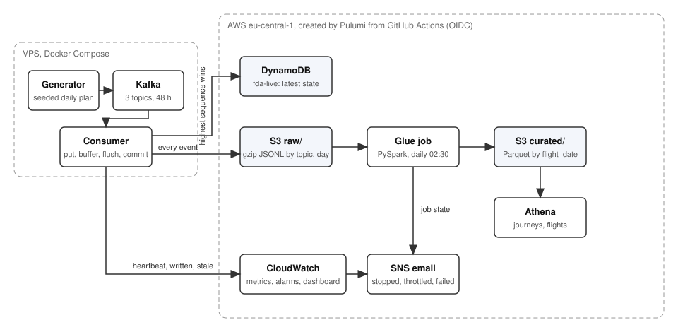
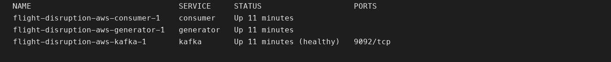
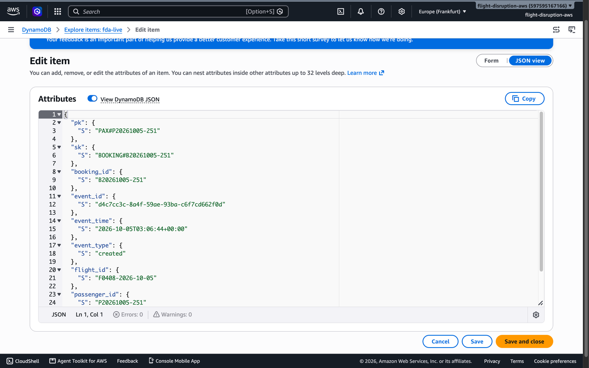
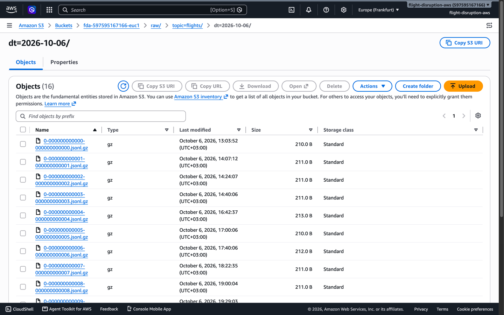
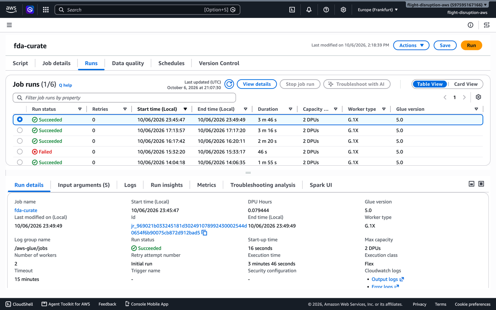
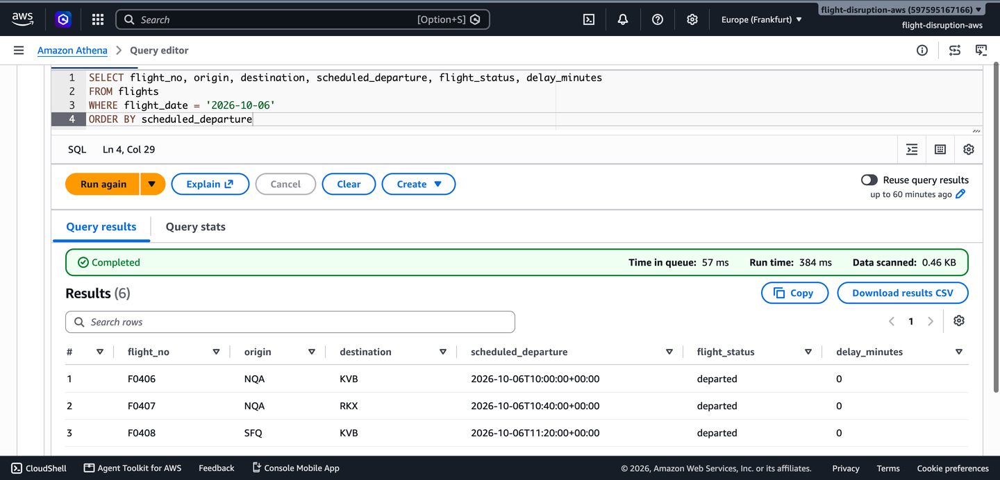
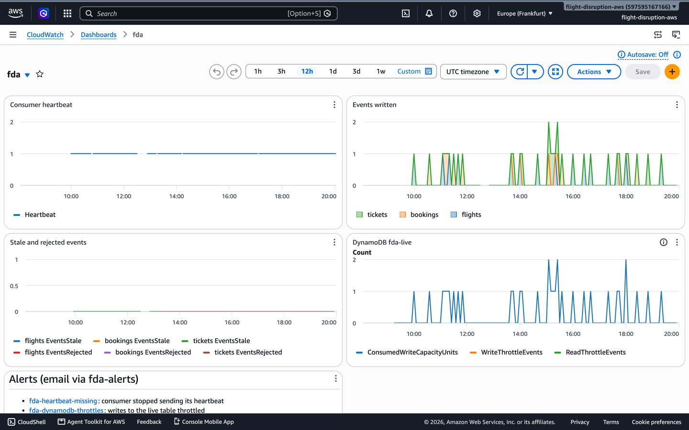
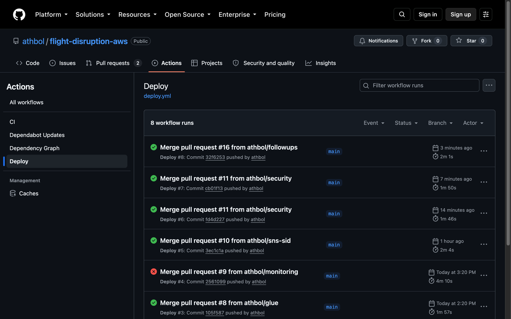
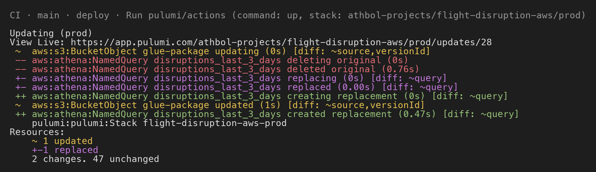

# flight-disruption-aws

A small airline runs 24 flights a day. Some flights are delayed or cancelled. Passengers on a cancelled flight are rebooked or refunded.

This repo rebuilds an airline disruption pipeline on AWS, with synthetic data:

- **Live path:** Kafka → consumer → DynamoDB, for "what is this passenger's status now?"
- **History path:** Kafka → consumer → S3 → daily Spark job → Athena, for "how many journeys were disrupted last week?"

Pulumi creates all AWS resources, and GitHub Actions deploys on every push to `main`. It costs under 1 USD a month.

I built it to show, with no customer data, how I would rebuild the disruption pipeline I worked on at an airline. It has the same problems: events arrive out of order, twice, or late.

## Architecture



| Step | Runs on | Does |
|------|---------|------|
| Generator | Docker on a VPS | Makes a day of flight, booking and ticket events from a seed. Some events are late, duplicated or out of order on purpose. |
| Kafka | Kafka 4.3 (KRaft), one broker, same VPS | Holds the events on three topics for 48 hours |
| Consumer | Docker on the same VPS | Writes each event to DynamoDB at once, and archives batches to S3 |
| DynamoDB `fda-live` | AWS | Holds the latest state of each flight, booking and ticket |
| S3 `raw/` | AWS | Holds every event as received |
| Daily job `fda-curate` | Glue 5.0 (PySpark), 2 workers, Flex | Cleans the archive and writes Parquet tables |
| Athena | AWS | Runs SQL on the Parquet tables |

Alarms email when the consumer stops, when DynamoDB throttles, or when the daily job fails.

## How each part works

### 1. Events and the data contract

Each event is one JSON message:

```json
{
  "event_id": "3f9c...",
  "event_type": "rebooked",
  "event_time": "2026-10-07T05:12:44+00:00",
  "sequence": 2,
  "booking_id": "B20261007-030",
  "passenger_id": "P20261007-030",
  "flight_id": "F0407-2026-10-07",
  "original_flight_id": "F0401-2026-10-07"
}
```

- `event_id`: the same for a duplicate, so duplicates are easy to drop.
- `sequence`: 1, 2, 3 per flight, booking or ticket. The highest number is the newest.

**Data contract:** `src/fda/schemas.py` lists the fields of each topic and of each output table. The generator, the consumer and the Spark job all import it, so they cannot drift apart. It is a shared module, not a schema registry.

### 2. Generator

`src/fda/generator.py`:

| Rule | Value |
|------|-------|
| Flights | 24 a day, 6 routes, 30 passengers each |
| Cancelled / delayed | 8% / 12% (15 to 240 minutes) |
| On a cancelled flight | 70% rebooked, 30% refunded |
| Late events | 85% within 5 s, 3% up to 36 h late |
| Duplicates | 2% sent twice |
| Held cancellations | 30% held back 1 to 3 h |

The same seed always gives the same day, so a run can be replayed.

### 3. Kafka

- Three topics: `flights`, `bookings`, `tickets`.
- One partition each. The key is the entity id, so the events of one booking stay in order.
- 48 hours of retention (`compose.yaml`). This is a buffer for a consumer outage, not the archive.

### 4. Consumer

`src/fda/consumer.py` reads all three topics. For each message:

1. **Write to DynamoDB** (`src/fda/live.py`). The write succeeds only if the item is new or the stored `sequence` is lower. A duplicate or an older event is skipped.
2. **Add to a buffer.**
3. **Count** it as written, stale or rejected.

When the buffer reaches **5,000 events, 16 MB or 5 minutes**:

1. Write the buffer to S3.
2. Then commit the Kafka offset.

A crash before the commit makes Kafka send the events again, so no event is lost.

Every 60 seconds the consumer sends a heartbeat and its counts to CloudWatch.

### 5. S3 bucket

| Prefix | Holds | Written by |
|--------|-------|------------|
| `raw/` | every event, gzip JSON lines | consumer |
| `curated/` | `journeys` and `flights`, Parquet | daily job |
| `artifacts/glue/` | the daily job's code | Pulumi, on deploy |
| `athena-results/` | query results | Athena |

A raw file name shows topic, arrival day, partition and offset range:

```
raw/topic=bookings/dt=2026-10-07/0-000000001200-000000001450.jsonl.gz
```

The raw archive is the source of truth. After a bug fix, a rerun rebuilds the tables from it.

### 6. Daily job

A Glue trigger starts `fda-curate` at 02:30 UTC. The logic is in `src/fda/curate.py`.

1. Read the last **4 days** of `raw/`.
2. Drop duplicates by `event_id`.
3. Keep the highest `sequence` per flight, booking and ticket.
4. Join each booking to its flight, its original flight and its ticket.
5. Label the disruption: `cancelled_rebooked`, `cancelled_refunded`, `delayed` or `none`.
6. Write Parquet, partitioned by `flight_date`. Overwrite only those 4 days.

### 7. DynamoDB vs Athena

| | DynamoDB | Athena |
|---|---|---|
| Question | Status of this passenger now | Disruptions by type last week |
| Holds | Latest state only | Full history |
| Speed | Milliseconds, by key | Seconds, full SQL |
| Fresh | At once | After the daily run |

Parquet and the `flight_date` folders let Athena read only the columns and days a query needs.

## It runs

Screenshots from the live system, in the order the data flows.

<table>
<tr>
<td width="50%" valign="top">1. <code>docker compose ps</code> on the VPS: generator, consumer and Kafka up, Kafka healthy.<br></td>
<td width="50%" valign="top">2. One booking in the live table, keyed by passenger and booking, with its sequence number.<br></td>
</tr>
<tr>
<td width="50%" valign="top">3. Raw archive, one object per flush.<br></td>
<td width="50%" valign="top">4. The daily job, succeeded.<br></td>
</tr>
<tr>
<td width="50%" valign="top">5. The curated <code>flights</code> table queried in Athena, a few hours into the first day.<br></td>
<td width="50%" valign="top">6. The <code>fda</code> dashboard: heartbeat, events written per topic, stale and rejected events (none yet) and DynamoDB write capacity.<br></td>
</tr>
<!-- 07-alarm-email.png is added with the passenger example on 2026-10-07 -->
<tr>
<td width="50%" valign="top">8. One CI run on main: the tests, then the deploy job.<br></td>
<td width="50%" valign="top">9. The Pulumi step of that deploy: one resource updated, one replaced, 47 unchanged.<br></td>
</tr>
</table>

## One passenger, two stores

The values below show the shape of the two records. A real rebooked passenger replaces them after the first full-day run on 2026-10-07.

**DynamoDB:** the latest event for the booking. One query by passenger returns their bookings and tickets.

```json
{ "pk": "PAX#...", "sk": "BOOKING#...", "event_type": "rebooked", "sequence": 2, "flight_id": "...", "original_flight_id": "..." }
```

**Athena** (`sql/passenger_journey.sql`): the booking joined with both flights and the ticket.

```
passenger_id | flight_id | flight_status | booking_status | original_flight_id | original_flight_status | ticket_status | disruption
P...         | F0...     | departed      | rebooked       | F0...              | cancelled              | exchanged     | cancelled_rebooked
```

## The hard parts

| Problem | Fix |
|---------|-----|
| **Out of order:** an old event arrives after a newer one | DynamoDB writes only if `sequence` is higher. The old event is counted as `EventsStale`. |
| **Duplicates:** the same event arrives twice | Same `event_id` (UUIDv5 of seed, entity and sequence). DynamoDB skips it. The daily job drops it with `dropDuplicates("event_id")`. |
| **Late:** an event arrives up to 36 hours late | The daily job rebuilds the last 4 days each night. A late event in today's `raw/` folder still fixes its flight's day. Older days are not touched. |
| **Crash:** the consumer stops mid-batch | The offset is committed only after the S3 write. Kafka sends the events again, and the two rules above absorb them. |

**Security:** each part has its own narrow IAM identity.

- Consumer: writes to one table, one S3 prefix and one metric namespace, only from the VPS address.
- Daily job: reads `raw/`, writes `curated/`.
- GitHub Actions: a deploy role through OIDC on `main`, read-only on pull requests. No stored AWS keys.
- Any role CI creates has a permissions boundary with no IAM or STS rights.

**Cost guards:**

- 1 USD monthly budget, with emails at 80% of actual and 100% of forecast spend.
- Athena cancels any query that scans more than 100 MB.
- Raw files expire after 30 days.

## Run it yourself

The tests need [uv](https://docs.astral.sh/uv/) and Java 17. uv installs Python 3.11 itself.

```sh
git clone https://github.com/athbol/flight-disruption-aws && cd flight-disruption-aws
uv sync --locked
uv run pytest
```

- Tests cover the generator, the DynamoDB write rule, the S3 layout, the consumer, the Spark job and every IAM policy.
- AWS calls go to moto, and Kafka and CloudWatch to fakes. No AWS account or broker is needed.
- To deploy, see [docs/runbook.md](docs/runbook.md).
- Saved queries: [disruptions_last_3_days](sql/disruptions_last_3_days.sql), [delayed_flights_yesterday](sql/delayed_flights_yesterday.sql), [passenger_journey](sql/passenger_journey.sql).

## Cost

Estimated monthly cost, before credits.

| Service | Use | USD / month |
|---------|-----|-------------|
| DynamoDB | 5 read and 5 write units, provisioned | 0 (free tier) |
| Glue | one Flex run a day, about 5 DPU-minutes | ~0.70 |
| S3 | a few MB, plus PUT requests | ~0.10 |
| Athena | KBs scanned per query | ~0 |
| CloudWatch | 10 metrics, 2 alarms, 1 dashboard | 0 (free tier) |
| SNS, EventBridge, Budgets, CloudTrail | | 0 |
| **Total** | | **under 1** |

The VPS is shared with other projects and not counted.

## Limits

- **Very late events:** an event that arrives more than about 3 days after its flight never reaches the curated tables. The generator never sends one that late.
- **One Kafka broker, no replication.** If the VPS disk fails, events not yet in S3 are lost.
- **No schema registry.** `schemas.py` is enough while one codebase owns every producer and consumer.
- **Malformed numbers:** the consumer rejects a decimal in `delay_minutes` or `amount_cents`. The daily job keeps the event with that field empty.
- **Generator downtime:** if all events of a flight were skipped, its bookings are missing from `journeys` for that day.
- **CI can create `fda-` roles.** The boundary blocks IAM and STS, but a compromised run could leave one behind.
- **CI uses a personal Pulumi token** stored as a GitHub secret.

[docs/decisions.md](docs/decisions.md) explains the design choices and their alternatives.

## Stack

Python 3.11, PySpark 3.5 on Glue 5.0, Apache Kafka 4.3 (KRaft), confluent-kafka, boto3, DynamoDB, S3, Parquet, Athena, Pulumi, IAM with GitHub OIDC, GitHub Actions, CloudWatch, SNS, EventBridge, CloudTrail, Docker Compose, uv, ruff, pytest, moto.

[MIT licence](LICENSE).
